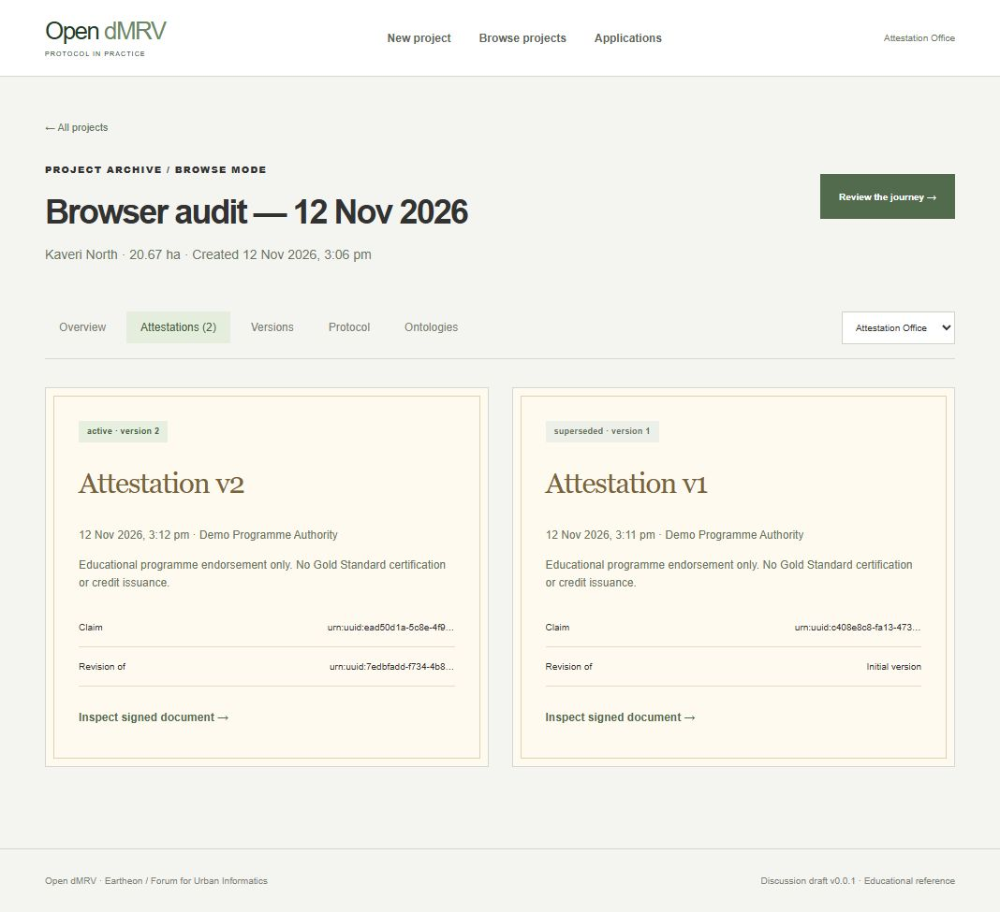

# Open dMRV example app review

Reviewed on 12 November 2026 using the ChatGPT internal browser at http://localhost:3000, the referenced conversation, and the current implementation. Digital Twins is intentionally excluded, following the user's clarification during this review.

**Verdict: the principal carbon demonstration works end to end. Several requested details remain partial, and this is still a local demonstration rather than a production deployment.**

## Requirement assessment

| Requirement | Assessment | Evidence and qualification |
|---|---|---|
| Short, contextual walkthrough for newcomers | Implemented, with UX gaps | Six steps explain the current role, task and next handoff. A project can be resumed. Failed verification still receives a checkmark; see findings below. |
| One application and port | Implemented | All eight role entry points and protocol endpoints operate on port 3000. The launcher starts Next.js and a durable worker, without the former role gateways. |
| Mapbox GL v3, Standard style, real coordinates | Implemented | The live map rendered field boundaries near Thanjavur, around 79.08 E / 10.77 N. The installed dependency is mapbox-gl 3.27.0; both the configured style and fallback are mapbox://styles/mapbox/standard. Boundaries are clearly marked as demonstration geometry. |
| Proper register/monitor/report/verify/attest APIs and callbacks | Implemented for this local flow | Used all five POST action endpoints through the UI. All five latest callbacks were delivered to /on_* with HTTP 200, matching request correlation IDs and transaction IDs. Requests received HTTP 202 ACKs. Receipts are saved in browser-audit-callbacks.json. |
| Postgres-backed projects, objects and exchanges | Implemented in the running flow | Created a named project, traversed its saved revisions, and reloaded its archive successfully. Backend paths use Postgres transactions and tables for projects, memberships, signed resources, messages, deliveries, grants and outbox jobs. A separate command-line DB check was denied local socket access; it was not evidence of a failure in the running app. |
| Different user profiles | Partial | Eight demo identities and membership checks exist. Users cannot create distinct accounts, assign their own participants or isolate their portfolios. Every new project automatically includes all eight fixed parties. |
| Older projects, attestations and revisions in each app | Mostly implemented | Opened all eight profile portfolios, the audit project's resource versions, and a pre-existing project's three attestation versions. Full historical request/callback JSON is not selectable by attempt. |
| Separate journey and browsing experiences | Implemented | The guided journey and archive/portfolio screens are separate. All eight profiles can browse project history. |
| Distinct frontends focused on each role | Partial | The journey has a land map, registration packet, laboratory table, reporting worksheet, assurance checks and endorsement certificate, with different visual treatments. Most portfolio screens reuse the same layout; the verifier queue, reporting ledger and observation workspace largely show the same project rows. Standards and registry add specialised content. |
| Use example-app rather than examples/carbon-market | Mostly implemented | The running app is in example-app with no carbon-market subfolder. The former examples/carbon-market copy remains, and the repository README still directs readers there. |
| pnpm | Implemented in package metadata; documentation incomplete | packageManager specifies pnpm@11.1.2 and pnpm lock/workspace files exist. README instructions still use npm. |
| Inline tampering while signing, rather than Trust Lab | Implemented | The signing panel exposes earlier signed objects and assets. Tested substituted CSV bytes, an honestly signed incorrect claim, and a changed inner claim retaining its original proof. |
| Failure callbacks and corrected revisions | Implemented for tested cases | DIGEST_MISMATCH returned to monitor; CALCULATION_MISMATCH and INVALID_SIGNATURE returned to report. Corrected submissions succeeded and preserved previous signed versions. |
| Request, ACK, callback and callback ACK JSON viewer | Implemented for the latest attempt | All four views work. Delivery URL, HTTP status, correlation and retry count are visible. The Attempts tab lists earlier attempts but cannot open their complete exchanges. |
| Reporter, verifier and attester access evidence/methodology via AssetReferences | Implemented locally; distributed deployment remains partial | All three roles expose retrieval controls. Successfully retrieved reporter CSV and methodology, verifier CSV, and attester methodology. Processing also retrieves all manifest assets and methodology through catalog, signed access-grant and evidence endpoints. The console shows HTTP 200/201 exchanges. Custodians and signing remain inside one trusted installation. |
| Signed objects and tamper-evident assets under public/ | Implemented for the demo | Resources and AssetReferences carry P-256/JCS proofs; files carry byte hashes. The three tested tamper/error cases were rejected. Public asset storage is intentional in this example. Independent cryptosuite interoperability was not tested. |
| AgrO, ENVO and a remote-sensing ontology in claims | Implemented as JSON-LD annotations | AgrO AGRO_00000416 types equipment; ENVO ENVO_00001998 types soil; RESEO Sentinel2Product, hasDataSource and DataSource describe satellite context. The claim and ontology screen disclose the terms and mappings. Carbon-specific terms use a demo vocabulary. No OWL reasoning or SHACL validation is implemented. |
| More production-ready behaviour | Substantial improvements, incomplete | Durable Postgres jobs, callbacks, revision checks, immutable signed resource updates, scoped demo sessions and integrity checks exist. Real account authentication, independent key custody and externally hosted custodians remain absent. |

## Remaining findings

1. **Profiles do not provide actual multi-user separation.** The session endpoint accepts any known demo role, and project creation inserts every fixed party into project_members. A visitor can switch to any signer. This is suitable for a walkthrough but only partially satisfies projects under different user profiles. See [http.ts](../server/http.ts), particularly the session handler, and [repository.ts](../server/repository.ts), createProject.

2. **The protocol archive cannot inspect a selected historical attempt.** ProtocolConsole always chooses requests[0]. Attempts displays IDs, timestamps and outcomes without a selector for older request, ACK and callback content. Asset exchanges are also limited to the latest 150 without pagination. After the new successful attestation, the earlier failed attestation callback remains stored but cannot be reopened from Attempts. See [application.tsx](../components/application.tsx), ProtocolConsole, and [repository.ts](../server/repository.ts), projectSnapshot.

3. **Failure presentation contradicts the actual outcome.** After the verifier rejected the 999 tCO2e claim with CALCULATION_MISMATCH, the stepper showed a checkmark beside Verify. After the attester rejected the changed inner claim, existing completed-step checkmarks were still shown. The marker tests whether a current resource exists, rather than whether the latest assessment succeeded. Failure notices also use the generic “signed result is saved” success wording, including a failed report with no new resource. The correction panel itself correctly reports the failure. See [application.tsx](../components/application.tsx), Journey stepper and notice rendering.

4. **Revision forms do not restore stored observations.** Journey initialises soil samples and cloud cover to constants; it does not hydrate them from the current monitoring revision. A new journey instance or reload can therefore show default observations rather than the data being corrected. The report worksheet also offers a formula and optional quantity, but no calculated estimate/deduction preview before signing the request. These are implementation findings; the audit used the default observations, so it did not establish a separate non-default-data loss case. See [application.tsx](../components/application.tsx), Journey state and report worksheet.

5. **Evidence access demonstrates protocol mechanics within one installation.** registeredPath rejects every other origin, internalFetch uses a shared service credential, and all signing keys are held by the local backend. The real HTTP access-grant flow works; independently administered custodians and signers are not supported by the current resolver. This does not require separate UI ports, but it does limit production decentralisation. See [assets.ts](../server/assets.ts) and [config.ts](../server/config.ts).

6. **Setup and repository documentation describe the previous app.** The app README still lists ports 3101–3108, npm commands, the Trust Lab and removed CLI operations. The repository README links to examples/carbon-market instead of example-app. The running implementation uses one port and pnpm metadata. See [app README](../README.md) and [repository README](../../README.md).

## Browser exercise and saved outcome

Created **Browser audit — 12 Nov 2026**, project ID **6a6e9670-5f1c-469b-aaeb-3ffd9ea7faa6**. Existing projects were only browsed.

1. Authorised Kaveri North, registered the project, and published monitoring evidence.
2. Substituted CSV content while signing a report. Received a delivered failed /on_report callback with DIGEST_MISMATCH and retryFrom monitor.
3. Republished monitoring evidence as EvidenceManifest v2.
4. Issued a validly signed claim for 999 tCO2e. Verification returned CALCULATION_MISMATCH and a signed changes_requested finding.
5. Reissued the claim using the computed 218.0272 tCO2e, verified it, and created Attestation v1.
6. Started an attestation revision. Changed the inner claim quantity to 777 while preserving its proof. The signed outer request was accepted, then /on_attest returned INVALID_SIGNATURE and retryFrom report.
7. Reissued the authentic claim, renewed verification, and created Attestation v2. Its revisionOf and supersedes fields link to v1; the archive marks v1 superseded and v2 active.
8. Reloaded the archive and confirmed both attestations remained available. Opened all eight portfolios and an older project's three attestation versions.

Final audit project state: complete; project revision 15; SubjectAuthorisation v1, RegistrationResult v1, EvidenceManifest v2, Claim v3, VerificationResult v3 and Attestation v2 current. The final verification and endorsement retain educational qualifications. No programme certification or carbon credit was issued.

[Open the audit project](http://localhost:3000/projects/6a6e9670-5f1c-469b-aaeb-3ffd9ea7faa6?profile=attester)

## Additional validation and limits

- Current example-app protocol tests: **15 passed, 0 failed**.
- TypeScript check: **passed**.
- Browser warnings/errors captured at the final review: **none**.
- Did not run a production build against the active development output directory, restart the user's server, or simulate a database outage.
- Did not independently exercise callback interruption/retry after restart, expired grants, revoked keys, multiple worker contention, or an external custodian. Those properties must not be treated as proven by the successful path.
- Did not run the dedicated database integration test against the user's application database. It requires a separate TEST_DATABASE_URL. The direct DB check encountered a local connection permission error; browser operations continued successfully.
- No application source was changed. The audit created one clearly named demonstration project, its signed history and source assets, and these review artifacts.

Supporting artifacts: [callback receipts](browser-audit-callbacks.json), [signature-failure screenshot](browser-audit-failure.jpg).
